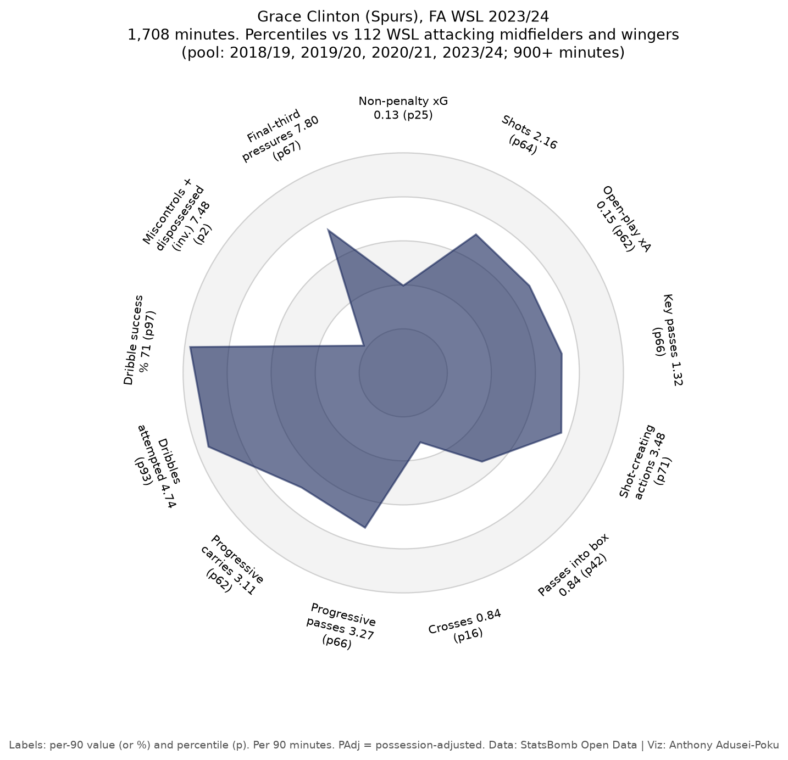
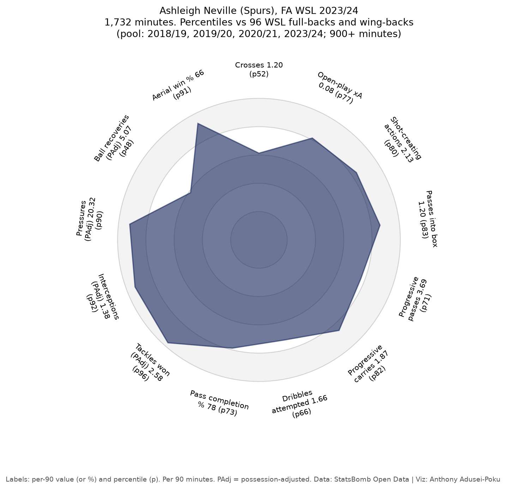
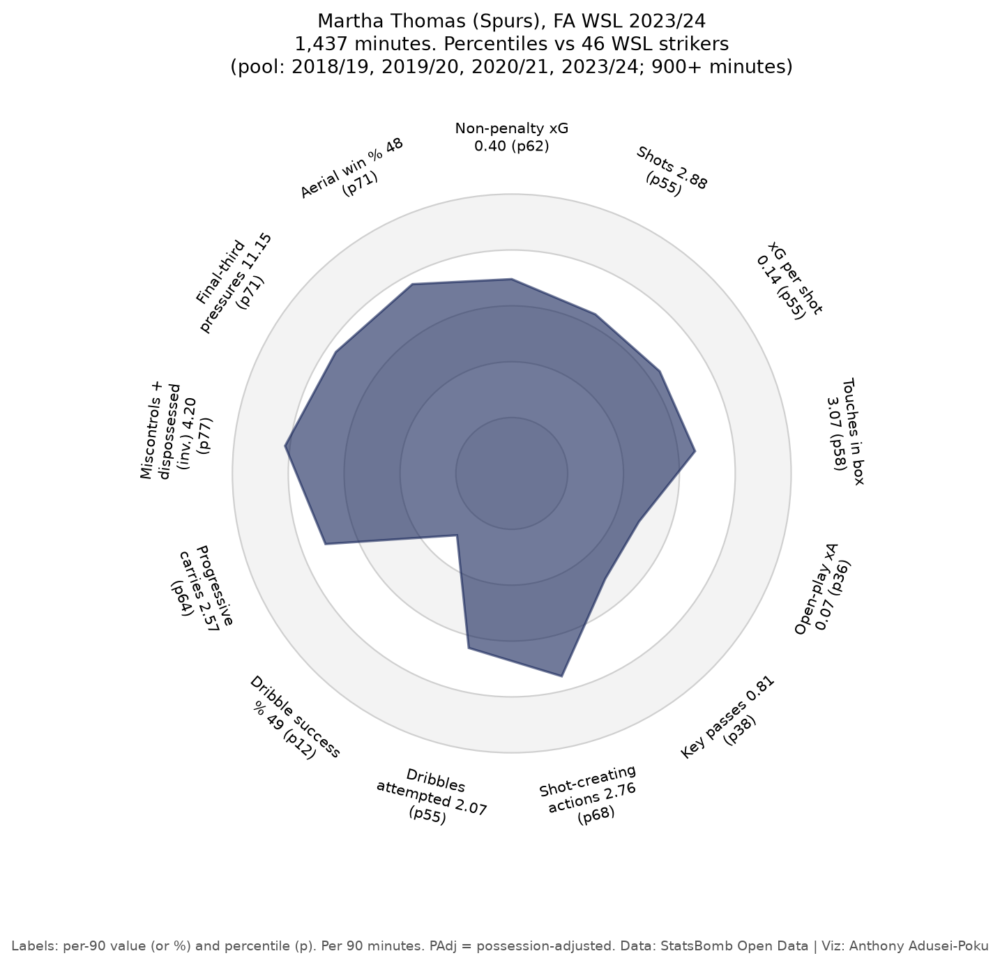
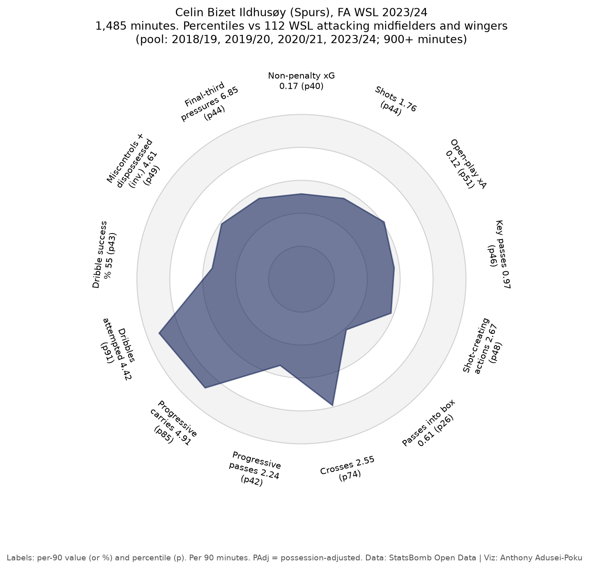
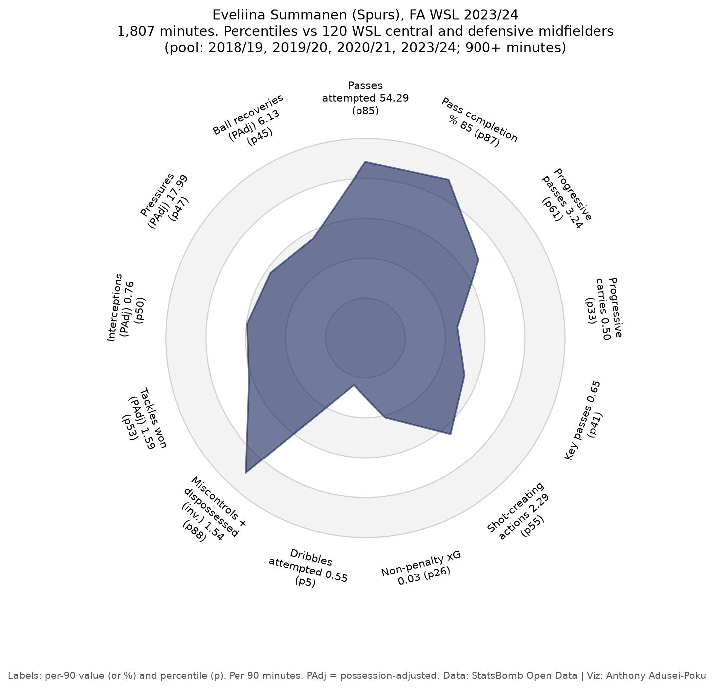
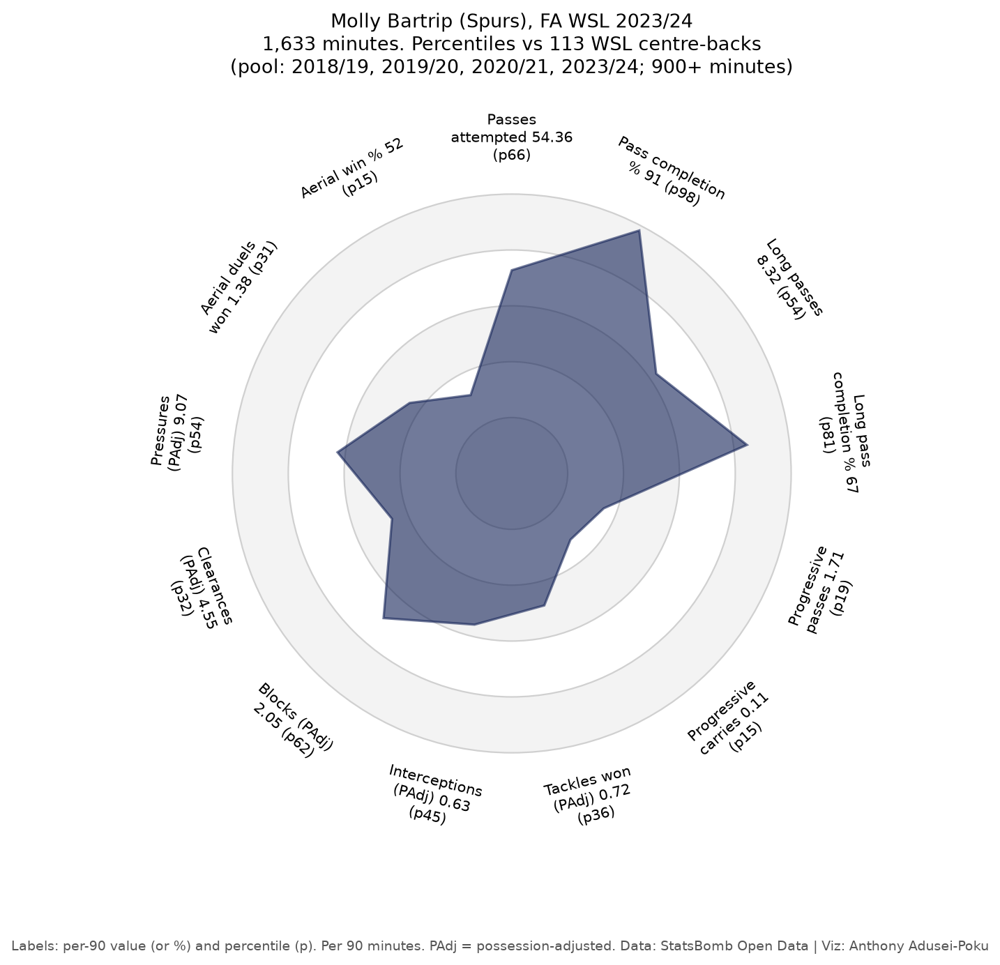

# Spurs Women in the FA WSL: xG, Shot Quality and Chance Creation

**My xG model and player-profile method applied to Tottenham Hotspur Women in the Women's Super League, using StatsBomb Open Data: how Spurs' chances for and against in 2023/24 compared with the rest of the league and with their first two WSL seasons (2019/20 and 2020/21), and which players drove them.**

*Anthony Adusei-Poku · MSc Data Science, University of East London (2025)*

   

<p align="center"></p>

> **What this is and isn't.** This is my method applied to Spurs Women on open data. The newest season available is 2023/24 (the last match is from May 2024), so it describes those seasons, not the current squad, and it is not a scouting report.

## TL;DR

* **2023/24 was Spurs' best season in the data.** Their non-penalty xG difference was **+0.10 a match (5th of 12)**, the first positive figure of their three seasons here, after **−0.89 (11th) in 2019/20** and **−0.55 (7th) in 2020/21**. They created **1.45 npxG a match (5th)**, up from 0.89 and 0.87, and finished 6th on points per match (31 points from 22 matches).
* **The improvement came from chance creation.** In 2023/24 Spurs made **8.7 key passes (4th), 22.5 shot-creating actions (5th) and 28.6 progressive passes (6th) a match**, compared with 4.4, 13.0 and 21.7 in 2020/21 and 6.6, 18.1 and 18.4 in 2019/20.
* **Shot quality still trails the league.** Spurs averaged **0.105 xG per shot in 2023/24 (7th)**, with **63.2% of shots from inside the box against 71.9%** for the rest of the league. In 2019/20 it was 0.074 xG per shot (11th) and 50.0% inside the box.
* **Players (2023/24):** **Grace Clinton** made 3.48 shot-creating actions per 90 (71st percentile) with a **71% dribble success rate (97th percentile)** of WSL attacking midfielders and wingers. **Ashleigh Neville** was in the **96th percentile** of full-backs for tackles won (possession-adjusted) and the 92nd for interceptions. **Martha Thomas** scored **7 non-penalty goals from 6.5 xG**.
* **The xG model transfers to the women's game.** My model ([football-xg-model](https://github.com/anthony07-max/football-xg-model)) is trained only on **57,664 men's shots**. On **11,711 WSL non-penalty shots** it gave **1,279.4 xG for 1,300 goals** (StatsBomb's own xG: 1,230.0), with log loss **0.2915** against **0.2951** for StatsBomb.

## 1. Data

[StatsBomb Open Data](https://github.com/statsbomb/open-data): full event data (every pass, carry, shot and defensive action, plus a freeze frame of player positions at each shot) for the FA WSL. These are all four WSL seasons in the open data.

| Season | Teams | Matches played | Matches in the data | Spurs matches played | Spurs matches in the data |
|---|---:|---:|---:|---:|---:|
| 2023/24 | 12 | 132 | 132 (100%) | 22 | 22 |
| 2020/21 | 12 | 132 | 131 (99%) | 22 | 21 (one of the two Birmingham City matches is missing) |
| 2019/20 | 12 | 87 (season curtailed in March 2020) | 87 (100%) | 15 | 15 |
| 2018/19 | 11 | 110 | 107 (97%) | not in the WSL | 0 |

* That is **457 matches and 11,816 shots** (11,711 non-penalty).
* 2018/19 has no Spurs matches (they were promoted in 2019) but is used for the model check and in the player radar comparison pool. There are no WSL seasons in the open data between 2020/21 and 2023/24.
* StatsBomb uses two names for some clubs in these files (for example "Manchester United" and "Manchester United W"); `src/wsl.py` maps each club to one name.

> Data © StatsBomb, used under the [StatsBomb Open Data licence](https://github.com/statsbomb/open-data/blob/master/LICENSE.pdf).
> Raw data is not included in this repository. The scripts in `src/` recreate it.

## 2. Method

### xG model
* `src/xg_model.py` re-trains the LightGBM model from football-xg-model with the **same features, filters, settings and match-based splits** (`src/features.py` is copied unchanged). On the same 11,585 held-out men's shots it scores log loss 0.2591, Brier 0.0736 and ROC AUC 0.807, against 0.2584, 0.0734 and 0.809 in the original repo. The small gap comes from row order: the download writes matches in the order they finish, and LightGBM's row subsampling depends on order, so this version sorts the shots first to give the same model on every run.
* **It is trained only on men's football** (big-five leagues 2015/16, men's World Cups, Euros, Copa América and AFCON, and the La Liga Messi seasons). No WSL shot is used in training, so every WSL prediction is out of sample.
* Team totals use **non-penalty xG** from my model. StatsBomb's xG is kept alongside as a check.

### Team metrics (per match, ranked within each season)
| Metric | Definition |
|---|---|
| npxG for / against | sum of my model's xG over non-penalty shots |
| xG per shot | npxG ÷ non-penalty shots |
| Key passes | open-play passes that lead directly to a shot |
| Shot-creating actions (SCA) | the two attacking actions directly before each non-penalty shot in the same possession: completed passes (including set pieces), completed dribbles, fouls won, and a shot that leads to a rebound (FBref-style) |
| Progressive passes | completed open-play passes, starting outside the defensive 30 yards, that move the ball at least 25% (and 5 yards) closer to goal |

### Player radars
* Per-90 profiles per player per season, **minimum 900 WSL minutes** in the data, goalkeepers excluded. Same approach as [football-scouting-tool](https://github.com/anthony07-max/football-scouting-tool): position group by most minutes played, possession-adjusted defending, success rates shrunk towards the league rate.
* **Comparison pool:** each metric is a percentile against every WSL player-season with 900+ minutes in the same position group across **all four seasons in the data: 2018/19, 2019/20, 2020/21 and 2023/24** (113 centre-backs, 96 full-backs, 120 central midfielders, 112 attacking midfielders and wingers, 46 strikers). Pooling gives bigger peer groups. As a check, `results/spurs_player_radars.csv` also gives each percentile against 2023/24 player-seasons only.
* Player xG on the radars is StatsBomb's, as in the scouting tool, so the radars do not depend on my model.

## 3. Spurs against the rest of the league

| Per match | 2023/24 | Rank (of 12) | 2020/21 | Rank | 2019/20 | Rank |
|---|---:|---:|---:|---:|---:|---:|
| Matches in data / points | 22 / 31 | 6th on points per match | 21 / 17 | 8th | 15 / 20 | 7th |
| npxG for | 1.45 | 5th | 0.87 | 9th | 0.89 | 8th |
| npxG against | 1.35 | 6th | 1.43 | 6th | 1.78 | 10th |
| npxG difference | +0.10 | 5th | −0.55 | 7th | −0.89 | 11th |
| Shots for / against | 13.8 / 13.2 | 5th / 6th | 9.3 / 13.1 | 9th / 6th | 12.0 / 17.1 | 6th / 11th |
| xG per shot (attack) | 0.105 | 7th | 0.094 | 10th | 0.074 | 11th |
| xG per shot conceded | 0.102 | 5th | 0.108 | 7th | 0.105 | 8th |
| Key passes | 8.7 | 4th | 4.4 | 9th | 6.6 | 6th |
| Shot-creating actions | 22.5 | 5th | 13.0 | 9th | 18.1 | 6th |
| Progressive passes | 28.6 | 6th | 21.7 | 9th | 18.4 | 11th |
| Possession (share of passes) | 49.3% | 7th | 48.6% | 7th | 47.2% | 9th |

* **2023/24: best of the rest.** Spurs had the fifth-best npxG difference, behind only Chelsea, Arsenal, Man City and Man United, and the fourth-most key passes per match.
* **Attack caught up with the defence.** The defensive gain came first: npxG conceded fell from 1.78 to 1.43 a match between 2019/20 and 2020/21 and was 1.35 in 2023/24. The attack only moved in 2023/24, when npxG for rose from 0.87 to 1.45 a match.
* **Shooting from further out than the league.** In 2023/24 Spurs' shots came from an average of 18.3 yards (rest of league 16.4) and 63.2% from inside the box (rest of league 71.9%). That is a big improvement on 2019/20 (22.3 yards, 50.0% inside the box), but still a gap.
* **Results versus xG.** In 2023/24 Spurs scored 31 non-penalty goals from 31.9 npxG, close to expectation, and conceded 32 from 29.8. In 2019/20 they conceded 21 from 26.8; in 2020/21 they scored 14 from 18.4.

<p align="center"></p>
<p align="center"></p>
<p align="center"></p>
<p align="center"></p>

## 4. Player radars (2023/24)

Six regular starters from 2023/24, one or two per position group. Labels show the per-90 value and the percentile against the four-season pool.

| Player | Group | Minutes | Stand-out numbers (per 90, percentile in the four-season pool) |
|---|---|---:|---|
| Martha Thomas | Striker | 1,437 | 7 non-penalty goals from 6.5 npxG; npxG 0.41 (62nd), SCA 2.76 (68th), final-third pressures 11.15 (71st) |
| Grace Clinton | Attacking midfield / wing | 1,708 | SCA 3.48 (71st), dribbles 4.74 (93rd), dribble success 71% (97th), but 7.48 miscontrols and dispossessions (2nd, inverted) |
| Celin Bizet Ildhusøy | Attacking midfield / wing | 1,485 | progressive carries 4.91 (85th), dribbles 4.42 (91st), crosses 2.55 (74th) |
| Eveliina Summanen | Central midfield | 1,807 | most minutes in the squad; 54.3 passes (85th) at 85% completion (87th), 1.54 miscontrols and dispossessions (88th, inverted) |
| Ashleigh Neville | Full-back | 1,732 | tackles won 2.58 (96th), interceptions 1.38 (92nd), pressures 20.3 (90th), SCA 2.13 (80th) |
| Molly Bartrip | Centre-back | 1,633 | pass completion 91% (98th), long-pass completion 67% (81st) |

<p align="center">
 
</p>
<p align="center">
  
</p>
<p align="center"></p>

## 5. Does a men's xG model work on WSL shots?

| Model (11,711 WSL non-penalty shots, 1,300 goals) | Log loss ↓ | Brier ↓ | ROC AUC ↑ | Total xG |
|---|---:|---:|---:|---:|
| **My model (trained on men's shots)** | **0.2915** | 0.0839 | **0.780** | **1,279.4** |
| *StatsBomb xG (benchmark)* | *0.2951* | ***0.0836*** | *0.775* | *1,230.0* |

* Across all four seasons my model is slightly ahead on log loss (−0.0036, 95% CI −0.0074 to +0.0000 from a 1,000-sample bootstrap over matches) and AUC, and StatsBomb is marginally ahead on Brier score. Shot by shot the two correlate at **r = 0.913**.
* **2023/24 alone:** the two are level on log loss (0.2993 mine, 0.2998 StatsBomb) and StatsBomb is ahead on AUC (0.775 against 0.770). My model gave 384.0 xG for 402 goals (StatsBomb 375.1).
* The calibration curve shows where the men's training data shows through: it **over-rates big chances**. Shots it valued at 0.45 or more produced **226 goals from 235.5 xG** (StatsBomb: 210.2).

<p align="center"></p>

## 6. Limitations
* **Still not current.** 2023/24 is the newest season in the open data. Squads, coaches and the league have changed since May 2024, so none of this describes the current Spurs Women team, and there is a three-season gap (2021/22 and 2022/23) in the data.
* **Men's training data.** The xG model has never seen a women's shot. It holds up well overall, but it over-rates the biggest chances in the WSL, and differences in goalkeeping and shooting between the men's and women's game are not modelled.
* **Small samples.** A WSL season is at most 22 matches, and no Spurs player in 2023/24 passed 1,810 minutes, so per-90 percentiles are noisy. Only 46 striker seasons pass the 900-minute filter.
* **Mixed eras in the radar pool.** The pool combines 2018/19 to 2020/21 with 2023/24, and the league grew more professional in between. The 2023/24-only percentiles in `results/spurs_player_radars.csv` are a check on this.
* **Incomplete coverage in the earlier seasons.** One Spurs match in 2020/21 and three 2018/19 matches are missing, and 2019/20 was cut short by COVID-19, so teams played between 13 and 16 matches.
* StatsBomb's open-data xG may come from a different version of their model than they use today.
* Shot-creating actions and progressive passes are my own implementations of public definitions, so they will not match FBref or StatsBomb numbers exactly.

## 7. Next steps
* Re-train or re-calibrate the xG model on WSL shots (for example isotonic calibration on held-out WSL matches) and compare with the men's-only version.
* Game-state splits (xG when level, ahead or behind) and set-piece xG for and against.
* Add new WSL seasons as StatsBomb releases them; the pipeline only needs the season id.

## 8. How to run

```bash
git clone https://github.com/anthony07-max/spurs-women-wsl-analysis.git && cd spurs-women-wsl-analysis
python -m venv .venv && source .venv/bin/activate
pip install -r requirements.txt
python src/download_wsl.py              # ~30 seconds; streams 457 WSL matches into data/wsl/
python src/download_training_shots.py   # a few minutes; men's training shots for the xG model (~210 MB)
jupyter nbconvert --to notebook --execute --inplace spurs_wsl.ipynb   # or open it in Jupyter
```

The notebook runs both download scripts itself if the data is missing.

## Repository structure
```
spurs-women-wsl-analysis/
├── spurs_wsl.ipynb                # full analysis (executed, with outputs)
├── spurs_wsl.html                 # static HTML export of the notebook
├── src/
│   ├── download_wsl.py            # streams WSL events into shots, team-match and player-match tables
│   ├── download_training_shots.py # men's shots for the xG model (from football-xg-model)
│   ├── features.py                # xG features (copied unchanged from football-xg-model)
│   ├── xg_model.py                # re-trains the football-xg-model LightGBM and scores new shots
│   └── wsl.py                     # team-season tables, ranks, player profiles, percentiles
├── figures/                       # all charts (PNG)
├── results/                       # coverage, model metrics, team table, Spurs matches, radars (CSV, JSON)
├── requirements.txt
└── cv_and_linkedin.md             # CV bullets and LinkedIn post
```

## Acknowledgements
Data provided by [StatsBomb](https://statsbomb.com/) through their free Open Data repository. Pitch plots and radars made
with [mplsoccer](https://mplsoccer.readthedocs.io/).
