# Spurs Women in the FA WSL: xG, Shot Quality and Chance Creation

**My xG model and player-profile method applied to Tottenham Hotspur Women's first two Women's Super League seasons (2019/20 and 2020/21), using StatsBomb Open Data: how Spurs' chances for and against compared with the rest of the league, and which players drove them.**

*Anthony Adusei-Poku · MSc Data Science, University of East London (2025)*

   

<p align="center">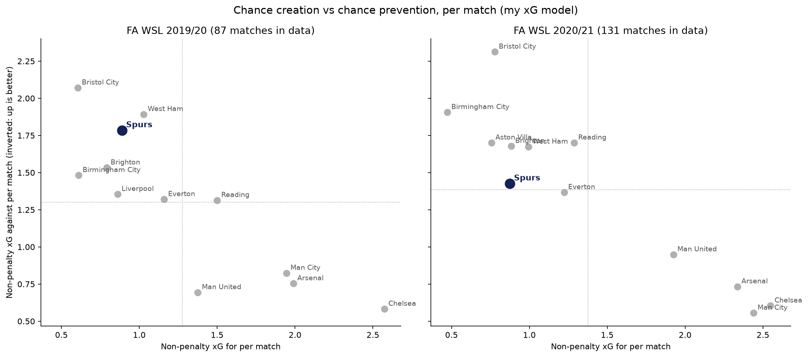</p>

> **What this is and isn't.** This is my method applied to Spurs Women on older open data (the last match is from May 2021). It describes those two seasons, not the current squad, and it is not a scouting report.

## TL;DR

* **The xG model transfers to the women's game.** My model ([football-xg-model](https://github.com/anthony07-max/football-xg-model)) is trained only on **57,664 men's shots**. On **8,205 WSL non-penalty shots** it gave **895.4 xG for 898 goals**, with log loss **0.2881** and ROC AUC **0.784**, compared with **0.2931 and 0.774 for StatsBomb's own xG** (difference −0.0050, 95% CI −0.0098 to −0.0008).
* **Spurs got much harder to create against in 2020/21.** Non-penalty xG conceded fell from **1.78 a match (10th of 12) in 2019/20 to 1.43 (6th) in 2020/21**, and shots conceded from **17.1 to 13.1 a match (11th to 6th)**. Their xG difference improved from −0.89 (11th) to −0.55 (7th).
* **The attacking problem was shot quality, not volume.** In 2019/20 Spurs took 12.0 shots a match (6th) but averaged only **0.074 xG per shot (11th of 12)**, with **50% of shots from inside the box** against 61% for the rest of the league. In 2020/21 it was 0.094 xG per shot (10th).
* **Finishing and goalkeeping swung the results.** In 2019/20 Spurs conceded **21 non-penalty goals from 26.8 xG against**. In 2020/21 they scored **14 non-penalty goals from 18.4 xG** and conceded 32 from 29.9.
* **Kit Graham was the creative hub.** In 2020/21 she made **1.77 key passes per 90 (89th percentile** of 84 WSL attacking midfielder and winger seasons) and 4.01 dribbles per 90 (84th). Ashleigh Neville was in the **98th percentile** of full-backs for both tackles won (possession-adjusted) and aerial win rate.

## 1. Data

[StatsBomb Open Data](https://github.com/statsbomb/open-data): full event data (every pass, carry, shot and defensive action, plus a freeze frame of player positions at each shot) for the FA WSL.

| Season | Teams | Matches played | Matches in the data | Spurs matches played | Spurs matches in the data |
|---|---:|---:|---:|---:|---:|
| 2018/19 | 11 | 110 | 107 (97%) | not in the WSL | 0 |
| 2019/20 | 12 | 87 (season curtailed in March 2020) | 87 (100%) | 15 | 15 |
| 2020/21 | 12 | 132 | 131 (99%) | 22 | 21 (one of the two Birmingham City matches is missing) |

* That is **325 matches and 8,287 shots** (8,205 non-penalty). Every shot has a freeze frame.
* 2018/19 has no Spurs matches (they were promoted in 2019) but is used for the league comparison in the player radars.
* StatsBomb uses two names for some clubs in these files (for example "Manchester United" and "Manchester United W"); `src/wsl.py` maps each club to one name.

> Data © StatsBomb, used under the [StatsBomb Open Data licence](https://github.com/statsbomb/open-data/blob/master/LICENSE.pdf).
> Raw data is not included in this repository. The scripts in `src/` recreate it.

## 2. Method

### xG model
* `src/xg_model.py` re-trains the LightGBM model from football-xg-model with the **same features, filters, settings and match-based splits** (`src/features.py` is copied unchanged). On the same 11,585 held-out men's shots the re-trained model scores log loss 0.2591, Brier 0.0736 and ROC AUC 0.807, against 0.2584, 0.0734 and 0.809 in the original repo. The small gap comes from row order: the download writes matches in the order they finish, and LightGBM's row subsampling depends on order, so this version sorts the shots first to give the same model on every run.
* **It is trained only on men's football** (big-five leagues 2015/16, men's World Cups, Euros, Copa América and AFCON, and the La Liga Messi seasons). No WSL shot is used in training, so every WSL prediction is out of sample.
* Team totals use **non-penalty xG** from my model. StatsBomb's xG is kept alongside as a check.

### Team metrics (per match, ranked within each season)
| Metric | Definition |
|---|---|
| npxG for / against | sum of my model's xG over non-penalty shots |
| xG per shot | npxG ÷ non-penalty shots |
| Key passes | open-play passes that lead directly to a shot |
| Shot-creating actions (SCA) | the two attacking actions directly before each non-penalty shot in the same possession: completed passes (including set pieces), completed dribbles, fouls won, and a shot that leads to a rebound (FBref-style) |
| Progressive passes | completed open-play passes, starting outside the defensive 30 yards, that move the ball at least 25% (and 5 yards) closer to goal |

### Player radars
* Per-90 profiles per player per season, **minimum 900 WSL minutes** in the data, goalkeepers excluded. Same approach as [football-scouting-tool](https://github.com/anthony07-max/football-scouting-tool): position group by most minutes played, possession-adjusted defending, success rates shrunk towards the league rate.
* Each metric is a **percentile against every WSL player-season in the same position group**, 2018/19 to 2020/21 (76 centre-backs, 68 full-backs, 87 central midfielders, 84 attacking midfielders and wingers, 32 strikers).
* Player xG on the radars is StatsBomb's, as in the scouting tool, so the radars do not depend on my model.

## 3. Does a men's xG model work on WSL shots?

| Model (8,205 WSL non-penalty shots, 898 goals) | Log loss ↓ | Brier ↓ | ROC AUC ↑ | Total xG |
|---|---:|---:|---:|---:|
| **My model (trained on men's shots)** | **0.2881** | 0.0829 | **0.784** | **895.4** |
| *StatsBomb xG (benchmark)* | *0.2931* | ***0.0826*** | *0.774* | *854.9* |

* My model is slightly better on log loss (−0.0050, 95% CI −0.0098 to −0.0008, a 1,000-sample bootstrap over matches) and AUC, StatsBomb marginally better on Brier score. Shot by shot the two correlate at **r = 0.912**.
* It is close in aggregate (895.4 xG for 898 goals), but the calibration curve shows where the men's training data shows through: it **over-rates big chances**. Shots it valued at 0.45 or more produced **159 goals from 174.5 xG** (StatsBomb: 153.0), and low-value shots went in slightly more often than predicted.

<p align="center">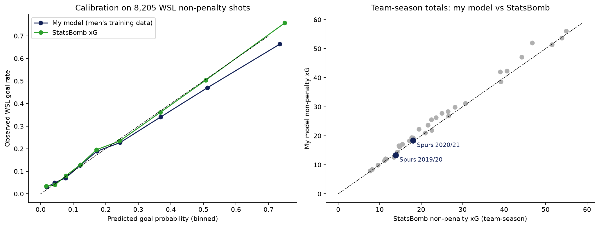</p>

## 4. Spurs against the rest of the league

| Per match | 2019/20 | Rank (of 12) | 2020/21 | Rank (of 12) |
|---|---:|---:|---:|---:|
| Matches in data / points | 15 / 20 | 7th on points per match | 21 / 17 | 8th on points per match |
| npxG for | 0.89 | 8th | 0.87 | 9th |
| npxG against | 1.78 | 10th | 1.43 | 6th |
| npxG difference | −0.89 | 11th | −0.55 | 7th |
| Shots for / against | 12.0 / 17.1 | 6th / 11th | 9.3 / 13.1 | 9th / 6th |
| xG per shot (attack) | 0.074 | 11th | 0.094 | 10th |
| xG per shot conceded | 0.105 | 8th | 0.108 | 7th |
| Key passes | 6.6 | 6th | 4.4 | 9th |
| Shot-creating actions | 18.1 | 6th | 13.0 | 9th |
| Progressive passes | 18.4 | 11th | 21.7 | 9th |
| Possession (share of passes) | 47.2% | 9th | 48.6% | 7th |

* **Defence first.** The biggest change between the seasons is at the back: 3.9 fewer shots and 0.36 less npxG conceded a match.
* **Lots of shots, few good ones.** In 2019/20 Spurs' shots came from an average of 22.3 yards (rest of league 19.2) and only 7.8% from inside the six-yard box. In 2020/21 more shots came from close range (55.6% in the box, 12.2% in the six-yard box), lifting xG per shot to 0.094, but the number of shots fell to 9.3 a match.
* **Creation fell as progression rose.** In 2020/21 Spurs moved the ball forward more (21.7 progressive passes a match, up from 18.4) but made fewer key passes (4.4, down from 6.6) and shot-creating actions (13.0, down from 18.1).
* **Results versus xG.** In 2019/20 Spurs conceded 5.8 fewer non-penalty goals than xG predicted (21 from 26.8), which kept their results ahead of the underlying numbers. In 2020/21 they scored 4.4 fewer than predicted (14 from 18.4).

<p align="center">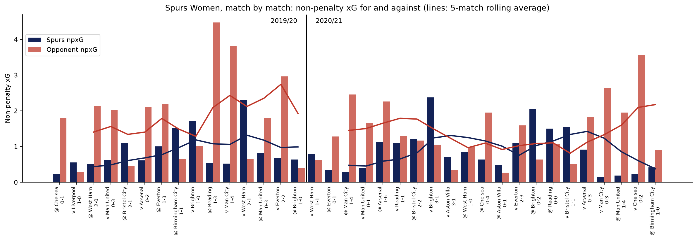</p>
<p align="center">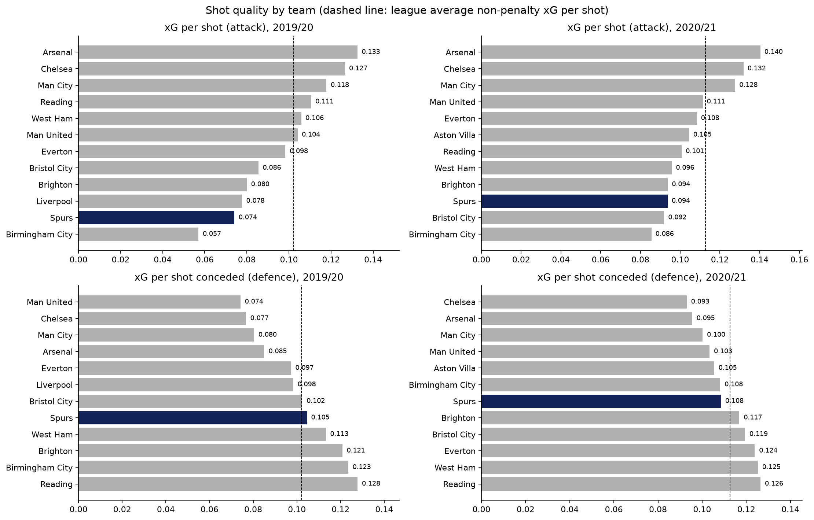</p>
<p align="center">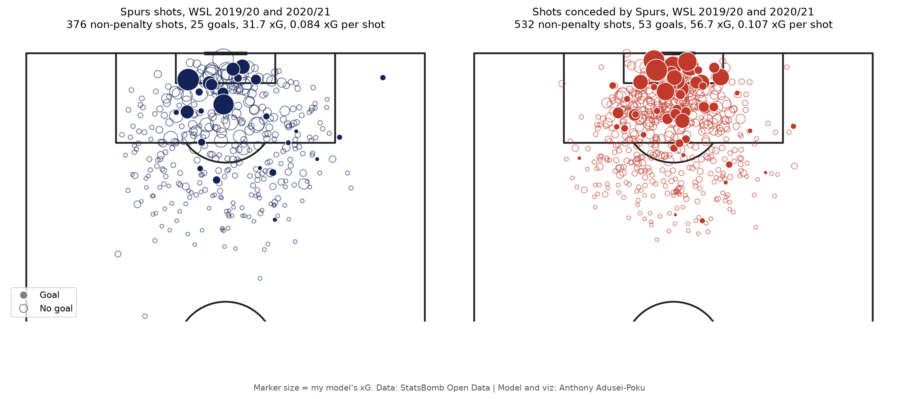</p>
<p align="center">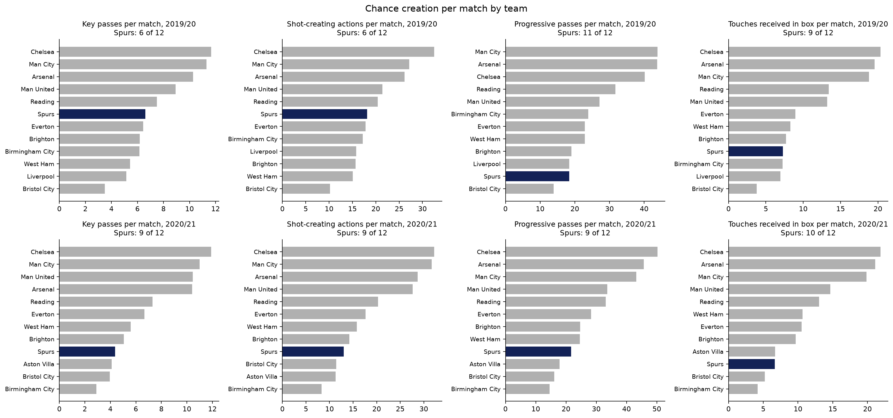</p>

## 5. Player radars (2020/21)

Six regular starters from Spurs' more complete season in the data. Labels show the per-90 value and the percentile.

| Player | Group | Minutes | Stand-out numbers (per 90, percentile) |
|---|---|---:|---|
| Shelina Zadorsky | Centre-back | 1,897 | most minutes in the squad; 45.0 passes (62nd), 79.7% completion (64th), interceptions 0.81 (62nd) |
| Ashleigh Neville | Full-back | 1,055 | tackles won 2.79 (98th), aerial win 72% (98th), dribbles 2.39 (90th) |
| Alanna Kennedy | Central midfield | 1,646 | interceptions 1.06 (79th), npxG 0.10 (63rd) |
| Kit Graham | Attacking midfield / wing | 1,166 | key passes 1.77 (89th), dribbles 4.01 (84th), SCA 3.55 (71st) |
| Angela Addison | Attacking midfield / wing | 1,321 | npxG 0.23 (71st), but key passes 0.14 (2nd): a finisher, not a creator |
| Rianna Dean | Striker | 916 | xG per shot 0.14 (58th) and pressing 10.0 final-third pressures (61st), but 0.98 shots (2nd) |

<p align="center">
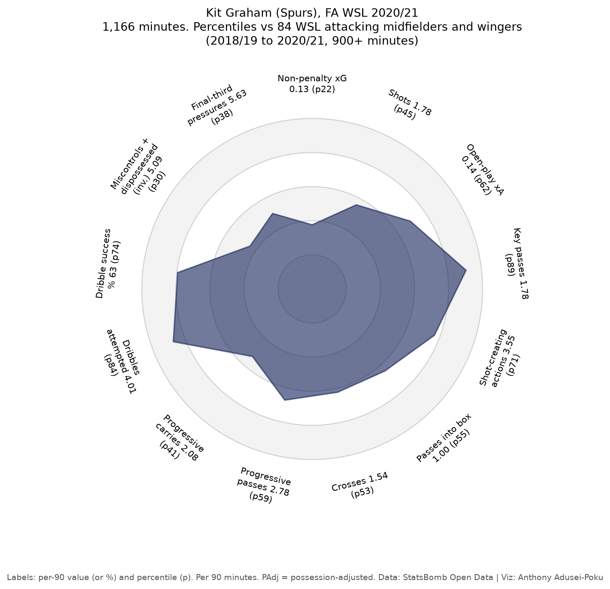 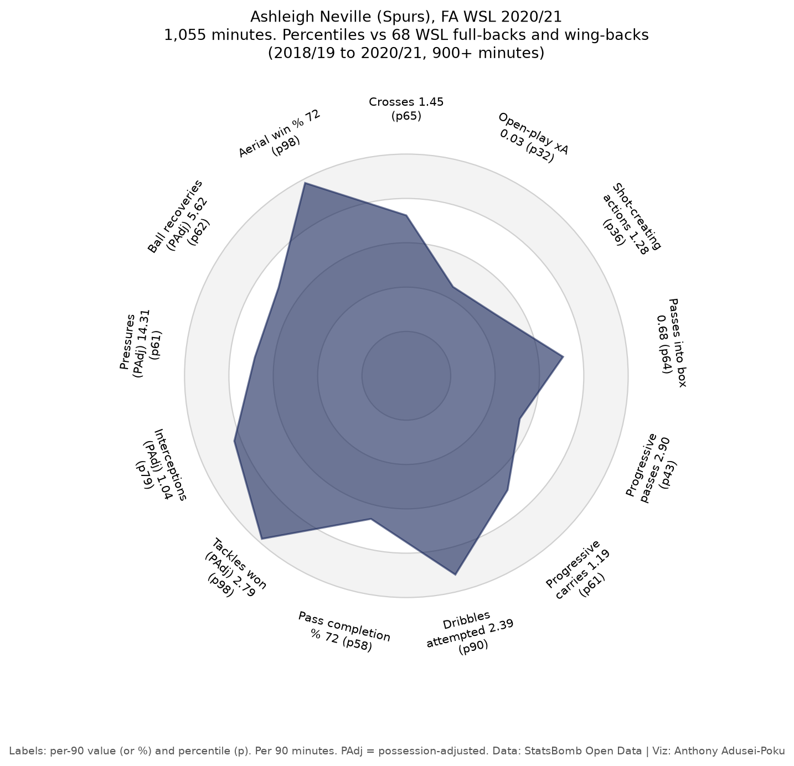
</p>
<p align="center">
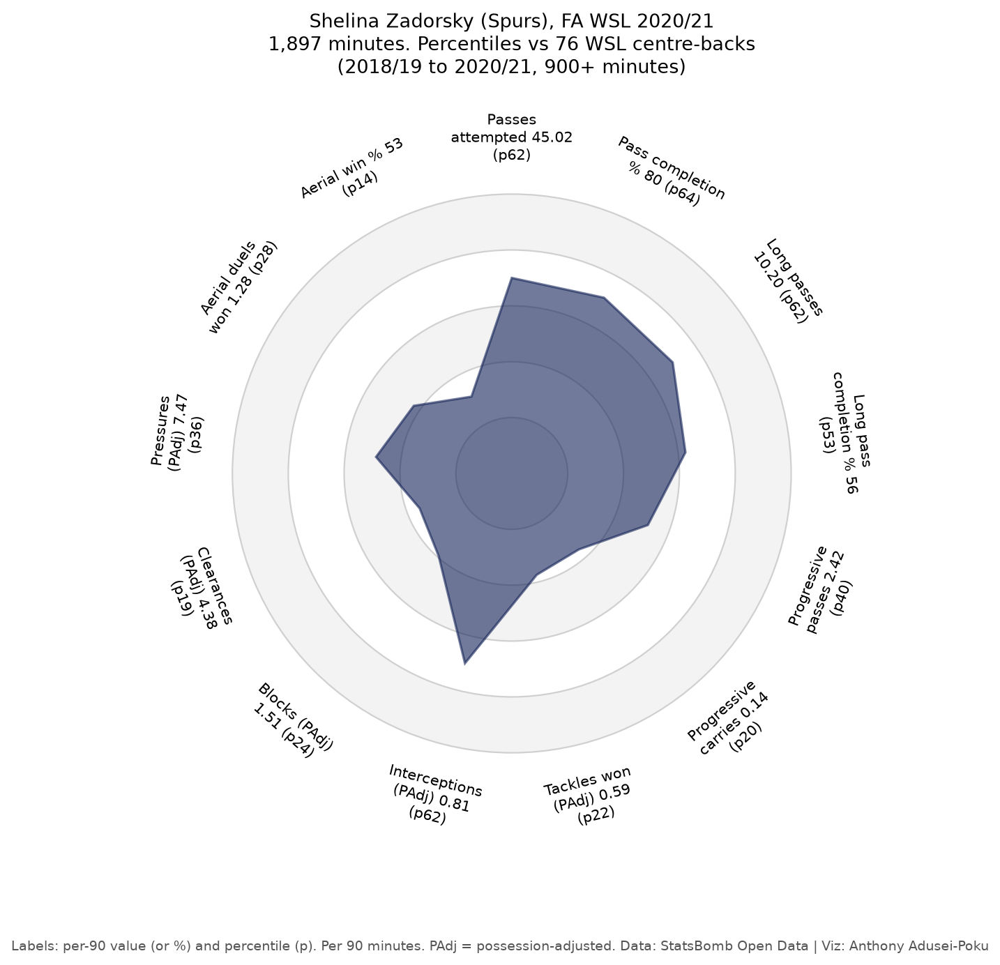 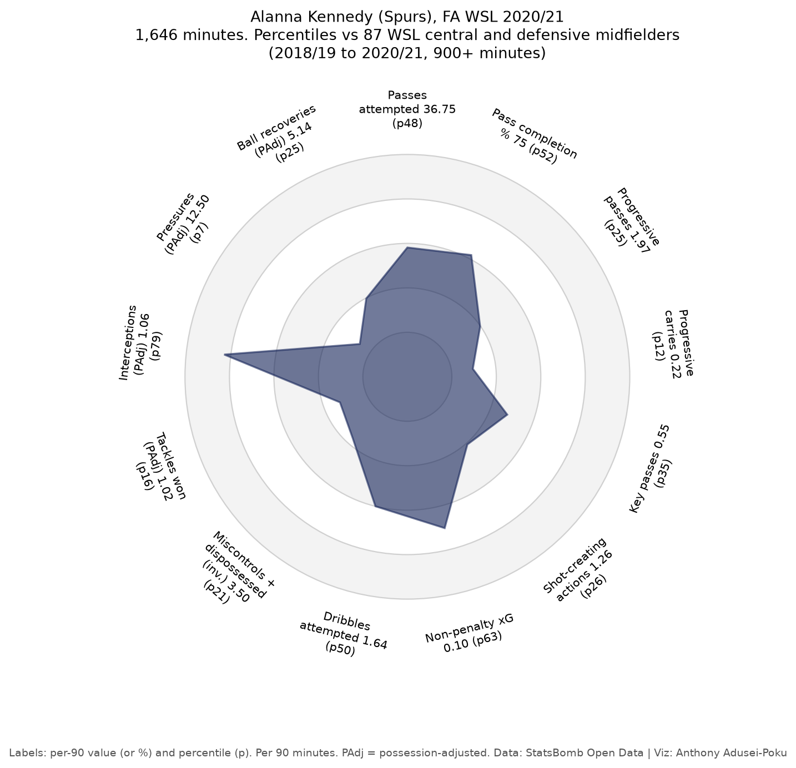 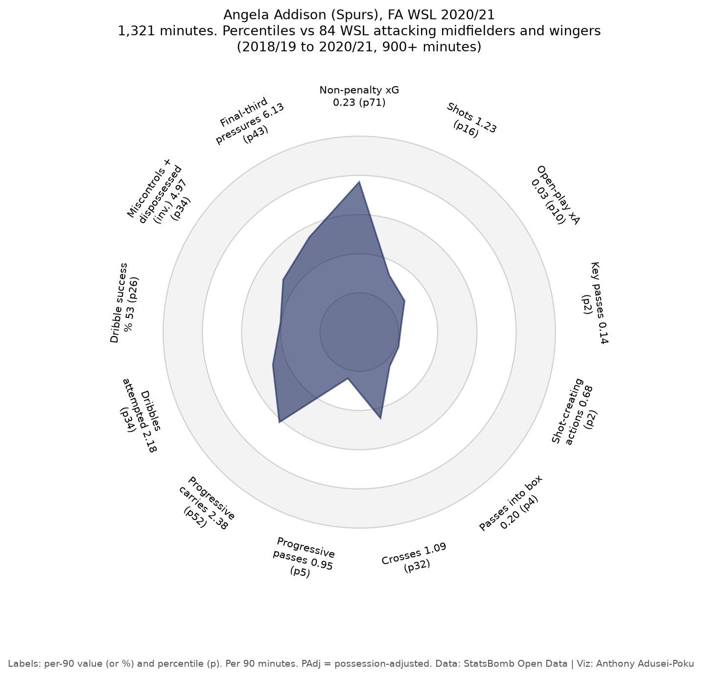
</p>
<p align="center">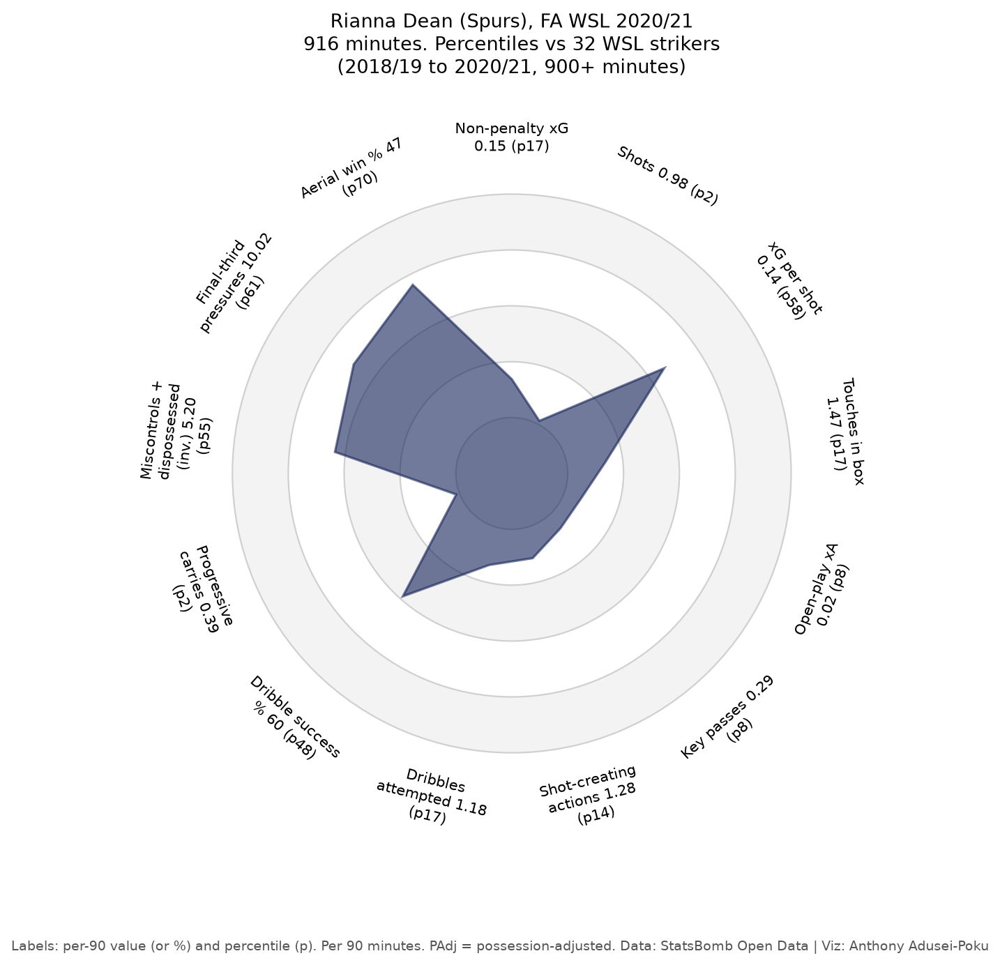</p>

## 6. Limitations
* **Old data.** The newest match is from May 2021. Squads, coaches and the league have changed a lot since, so none of this describes the current Spurs Women team.
* **Small samples.** Spurs have 36 matches in the data and individual players at most 1,897 minutes in a season, so per-90 percentiles are noisy. Only 32 striker seasons pass the 900-minute filter, so striker percentiles move a lot with one player.
* **Incomplete coverage.** One Spurs match (against Birmingham City in 2020/21) and three 2018/19 matches are missing. 2019/20 was cut short by COVID-19, so teams played between 13 and 16 matches.
* **Men's training data.** The xG model has never seen a women's shot. It performs well overall, but it over-rates the biggest chances in the WSL, and differences in goalkeeping and shooting between the men's and women's game are not modelled.
* StatsBomb's open-data xG for these seasons may come from an older version of their model than they use today, which could flatter my comparison.
* Shot-creating actions and progressive passes are my own implementations of public definitions, so they will not match FBref or StatsBomb numbers exactly.

## 7. Next steps
* **Add WSL 2023/24.** StatsBomb Open Data now also covers the 2023/24 WSL (all 132 matches, including all 22 of Spurs'); the pipeline only needs the season id added.
* Re-train or re-calibrate the xG model on WSL shots (for example isotonic calibration on held-out WSL matches) and compare with the men's-only version.
* Game-state splits (xG when level, ahead or behind) and set-piece xG for and against.

## 8. How to run

```bash
git clone https://github.com/anthony07-max/spurs-women-wsl-analysis.git && cd spurs-women-wsl-analysis
python -m venv .venv && source .venv/bin/activate
pip install -r requirements.txt
python src/download_wsl.py              # ~30 seconds; streams 325 WSL matches into data/wsl/
python src/download_training_shots.py   # a few minutes; men's training shots for the xG model (~210 MB)
jupyter nbconvert --to notebook --execute --inplace spurs_wsl.ipynb   # or open it in Jupyter
```

The notebook runs both download scripts itself if the data is missing.

## Repository structure
```
spurs-women-wsl-analysis/
├── spurs_wsl.ipynb                # full analysis (executed, with outputs)
├── spurs_wsl.html                 # static HTML export of the notebook
├── src/
│   ├── download_wsl.py            # streams WSL events into shots, team-match and player-match tables
│   ├── download_training_shots.py # men's shots for the xG model (from football-xg-model)
│   ├── features.py                # xG features (copied unchanged from football-xg-model)
│   ├── xg_model.py                # re-trains the football-xg-model LightGBM and scores new shots
│   └── wsl.py                     # team-season tables, ranks, player profiles, percentiles
├── figures/                       # all charts (PNG)
├── results/                       # coverage, model metrics, team table, Spurs matches, radars (CSV, JSON)
├── requirements.txt
└── cv_and_linkedin.md             # CV bullets and LinkedIn post
```

## Acknowledgements
Data provided by [StatsBomb](https://statsbomb.com/) through their free Open Data repository. Pitch plots and radars made
with [mplsoccer](https://mplsoccer.readthedocs.io/).
